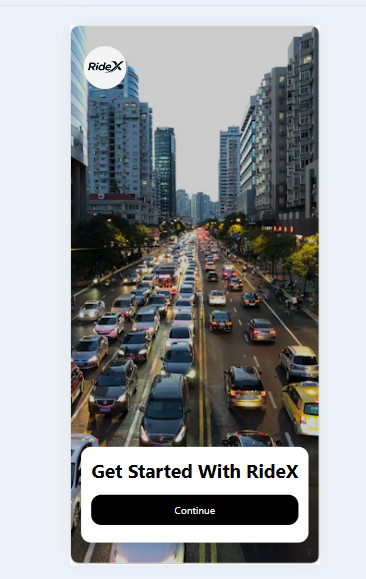
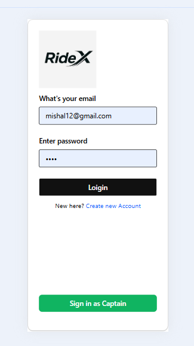
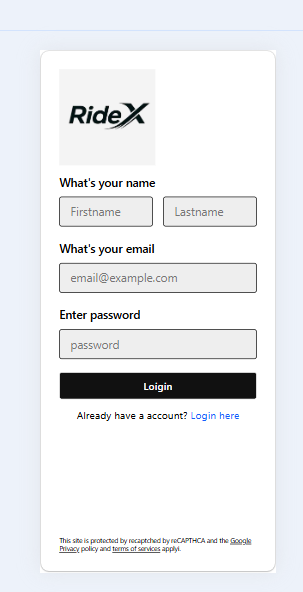
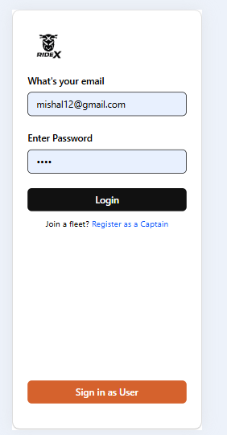
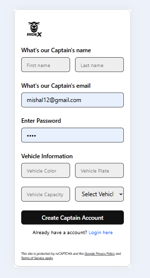

# RideX Frontend

RideX is a ride-sharing application with separate user and captain flows. This project contains the frontend part of the app and provides a clean UI for home, login, signup, and authentication screens.

## Project Overview

- User registration and login
- Captain registration and login
- Home page landing screen
- Responsive UI for ride-sharing flow
- React-based frontend structure

## Tech Stack

- React
- Vite
- React Router DOM
- JavaScript
- CSS

## Folder Structure

```text
Frontend/
├── public/
├── src/
│   ├── assets/
│   │   └── screenShorts/
│   │       ├── background.jpg
│   │       ├── captainLogin.png
│   │       ├── captainSignup.png
│   │       ├── HomePage.png
│   │       ├── login.png
│   │       └── signup.png
│   ├── Pages/
│   │   ├── CaptainLogin.jsx
│   │   ├── CaptainSignup.jsx
│   │   ├── Home.jsx
│   │   ├── UserLogin.jsx
│   │   └── UserSignup.jsx
│   ├── App.jsx
│   ├── App.css
│   ├── index.css
│   ├── main.jsx
│   └── context/
│       └── UserContext.jsx
├── index.html
├── package.json
├── vite.config.js
├── README.md
└── public/
```

## App Flow

1. App loads from `main.jsx`
2. `App.jsx` manages routing between pages
3. User can open the home page
4. User can navigate to login or signup pages
5. Captain can login or create a captain account
6. Future backend APIs will connect the frontend to real authentication

### Main Routes

- `/` -> Home page
- `/user/login` -> User login
- `/user/signup` -> User signup
- `/captain/login` -> Captain login
- `/captain/signup` -> Captain signup

## Frontend Screens

### 1. Home Screen



This is the home screen of the app. It shows the RideX branding and a start card with the main call-to-action button.

### 2. User Login



This page allows a user to sign in using their email and password.

### 3. User Signup



This form helps a new user create a rider account with personal details.

### 4. Captain Login



This page is for captains to log in to their account securely.

### 5. Captain Signup



This form allows a captain to register by entering personal and vehicle information.

### 6. Background Branding


This background image reflects the app's ride-sharing style and city travel theme.

## Backend Integration Notes

The frontend is designed to work with the backend APIs for:

- User registration
- User login
- User profile fetch
- Captain registration
- Captain login
- Captain profile fetch


## Run Project Locally

Open the terminal in the `Frontend` folder and run:

```bash
npm install
npm run dev
```

Then open the browser:

```text
http://localhost:5173
```

## Build for Production

```bash
npm run build
```

This creates the production build for deployment.

## Notes

- These pages are currently UI-based and can be extended with real API integration.
- The app structure is ready for adding authentication and ride features.
- The project is organized so that frontend and backend can be developed separately.

## Summary

RideX Frontend is the user interface layer of the ride-sharing app. It includes the home screen, user login/signup pages, captain login/signup pages, and the overall structure needed to connect with the backend services.
